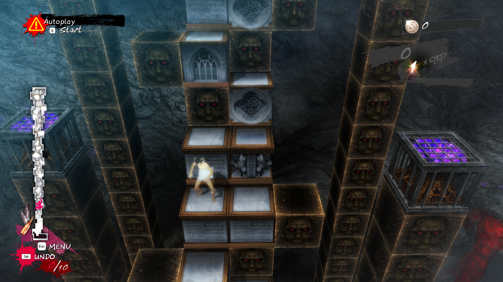
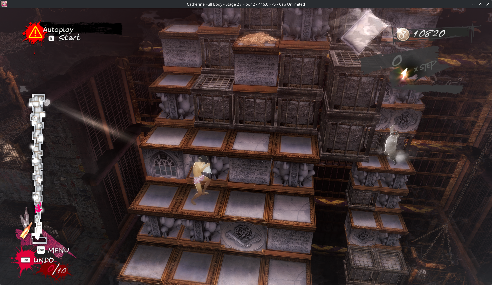
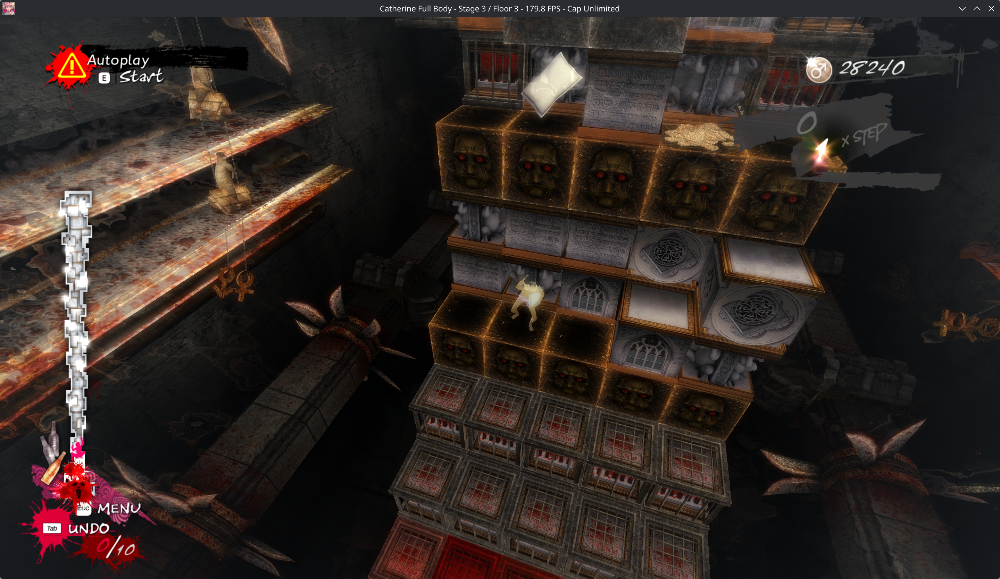
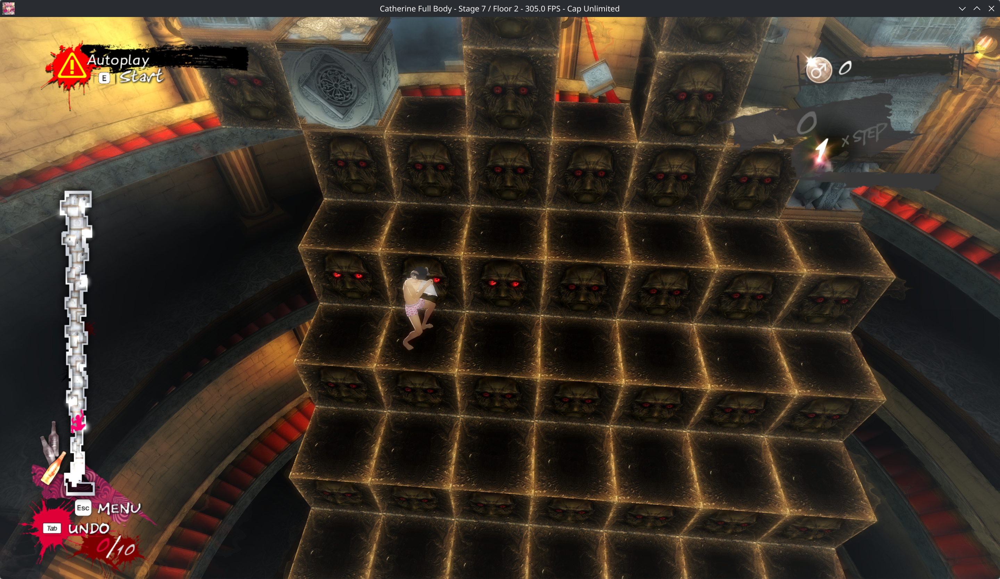
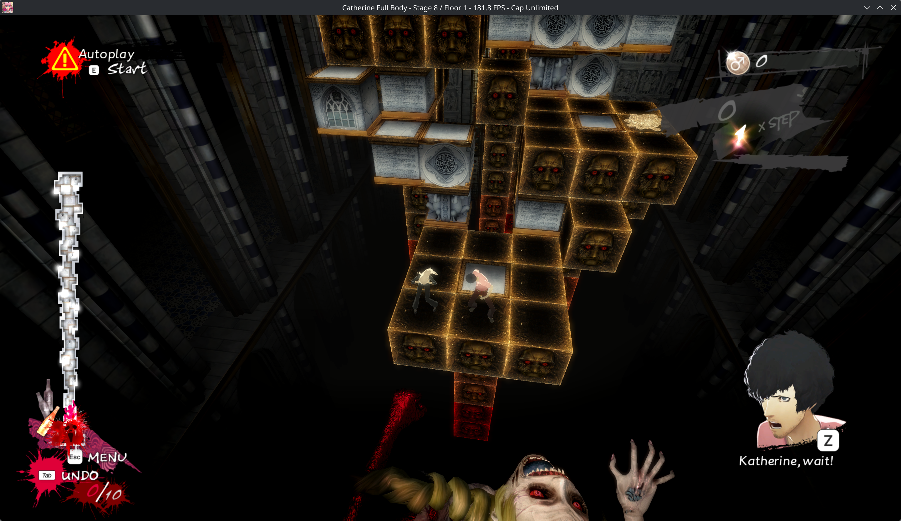

# Catherine: Full Body PC Port

Based on the Switch version of the game, there was a shadps4 wrapper of this game available but that version is still locked to 30fps and is more of a no-frill type of recomp. I'm still going to thank and appreciate its existence though, because this was what got me interested in the game again.

I will say this has been a way more complicated port than anything else I've released so I'm less confident about this one.

## Features

- Native Windows and Linux support.
- 60 FPS by default, with an uncapped option. Code patches and interpolation enable higher frame rates, You'd be surprised just how many things broke when you go over 30 fps, most have been fixed but there may be minor things left that still run at the wrong speed.
- Full keyboard and mouse support.
- Button prompts switch automatically between keyboard and mouse icons and the active controller’s icons.
- Updated Menus, Xbox controllers and more now have updated tutorials.
- Real game configuration options that are inside of the game like a real PC game. Includes things like MSAA anti-aliasing and FMV smoothing.
- Local co-op. Online play had to be removed. Babel Pair and Colosseum automatically use local co-op and stay greyed out until two distinct input devices are connected and assigned.

## Screenshots


<details>
<summary>Configuration and bindings (4K)</summary>

| | |
| --- | --- |
| <br>Game | <br>Display |
| <br>Controls | <br>System |
| <br>Audio | <br>Player 1 bindings |
| <br>Player 2 bindings |  |

</details>

<details>
<summary>Ten puzzle floors on Linux with live FPS</summary>

| | |
| --- | --- |
| <br>Stage 1, Floor 1 | <br>Stage 2, Floor 2 |
| <br>Stage 2, Floor 3 | <br>Stage 3, Floor 3 |
| <br>Stage 5, Floor 1 | <br>Stage 7, Floor 1 |
| <br>Stage 7, Floor 2 | <br>Stage 8, Floor 1 |
| <br>Stage 9, Floor 3 | <br>Stage 9, Floor 5 |

</details>

## System requirements

These are estimated hardware targets for 1080p with anti-aliasing off, not verified minimum requirements. Performance will vary by scene and settings; Linux hardware targets have not been separately validated.

| Component | 1080p / 60 FPS target | 1080p / 120 FPS target |
| --- | --- | --- |
| CPU | Intel Core i5-10400 / AMD Ryzen 5 3600 or equivalent | Intel Core i5-12400F / AMD Ryzen 5 5600 or equivalent |
| GPU | NVIDIA GeForce GTX 1660 Super / AMD Radeon RX 5600 XT or equivalent | NVIDIA GeForce RTX 3060 Ti / AMD Radeon RX 6700 XT or equivalent |
| RAM | 8 GB estimated minimum; 16 GB recommended | 16 GB |
| Storage | 20 GB free for the installed game; allow approximately 35 GB during setup, including extracted game files | Same |

A 64-bit x86-64-v3-capable CPU and a Vulkan-capable graphics card with current drivers are required.

## Installation

1. Use your own copy of the North American or European Nintendo Switch release (title ID `0100BF00112C0000`) and its 1.0.1 update. Decrypt and extract the update together with the base game to produce one merged extraction folder. You can use a tool such as NSPUnpacker to prepare the files. The port accepts extracted files only.
2. On Windows, launch `Catherine.exe` and point setup at the extracted files when prompted. Setup builds `assets.pak`, then generates the Vulkan shaders. See the [Windows setup guide](Source/resources/INSTALL-ASSETS.txt) for details.
3. On Linux, launch `./Build/catherine` and select the merged extraction folder when prompted. The built-in installer creates `assets.pak` and then generates the Vulkan shaders. First-time setup uses SPIRV-Tools and KDialog or Zenity. Building the executable requires the .NET 10 SDK.

### Example extracted folder structure

Select the single `ExtractedGame` folder when setup asks for the game files. This folder contains the base game with the 1.0.1 update applied during extraction. The folder name is an example; it can be stored anywhere.

```text
ExtractedGame/
├── exefs/
└── romfs/
```

Keep all files inside both folders. Select `ExtractedGame` during setup; no separate update folder is needed. Setup reads the files in place and builds `assets.pak`, then generates the Vulkan shaders.

## Compile from source

Clone this repository and run the build commands from the checkout root. Original game files are only needed when setting up the built game, not when compiling it.

### Windows

Install:

- Python 3 and the .NET 10 SDK.
- Visual Studio with the **Desktop development with C++** workload, LLVM/Clang tools, and the Windows SDK.
- The Vulkan SDK, including its headers.

**Windows source builds currently require the existing developer build environment.** The build recipe still contains machine-specific paths; automatic toolchain and SDK detection has not been implemented yet. These are not portable fresh-checkout instructions. For now, use a Windows release build or compile from source on Linux.

In an already configured Windows developer checkout, run this from the checkout root in a Visual Studio Developer PowerShell:

```powershell
New-Item -ItemType Directory -Force Build\obj | Out-Null
python build.py --jobs 12
```

The executable is `Build\catherine.exe`. Build logs are written to `Build\logs`.

### Linux

Use an x86-64-v3-capable Linux system. Install Python 3, Clang, LLD, the .NET 10 SDK, pkg-config, and development files for Vulkan, SDL2, Cairo, OpenSSL, and FFmpeg (`libavcodec`, `libavutil`, and `libswscale`). The checkout can be in any directory; the Linux build script translates the recorded Windows project paths automatically.

```sh
python3 build.py --jobs 12
```

The executable is `Build/catherine`. Launch it with:

```sh
./Build/catherine
```

If your Vulkan headers are outside the compiler's default include path, set `CATHERINE_VULKAN_INCLUDE` to the directory containing the `vulkan` subdirectory. `CC` and `CXX` can select alternative Clang executables. Build logs are written to `Build/logs/linux`.

For first-time game setup on Linux, also install SPIRV-Tools (`spirv-as`, `spirv-dis`, and `spirv-val`) and either KDialog or Zenity. Linux builds currently do not support `--pgo`.

## Planned

- Further optimisation.
- A custom level editor.
- More configuration options like FSR and DLSS.
- Restore the voting system. Other online features are outside my plans, but forks and pull requests are welcome.

## AI

Yes. I used AI.
