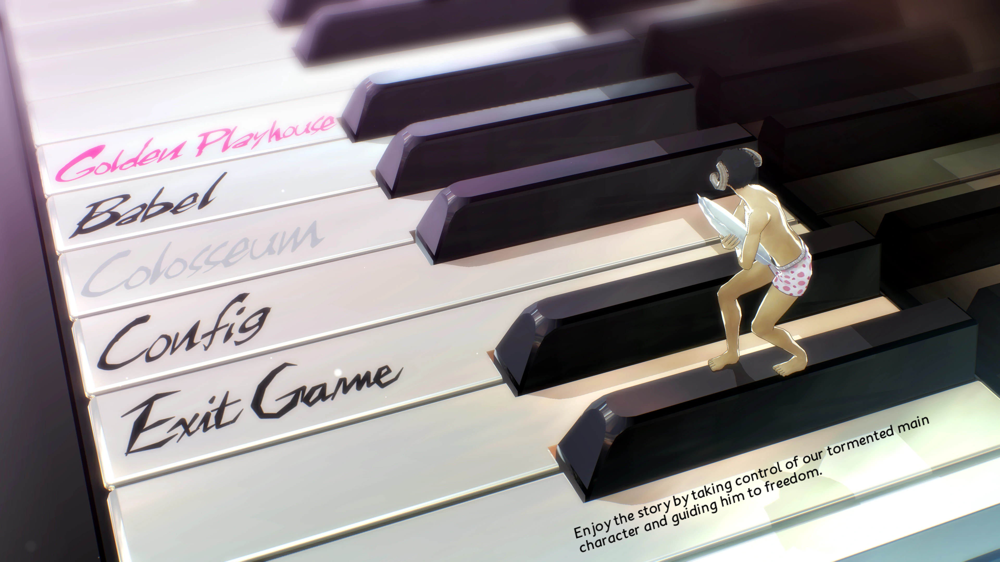
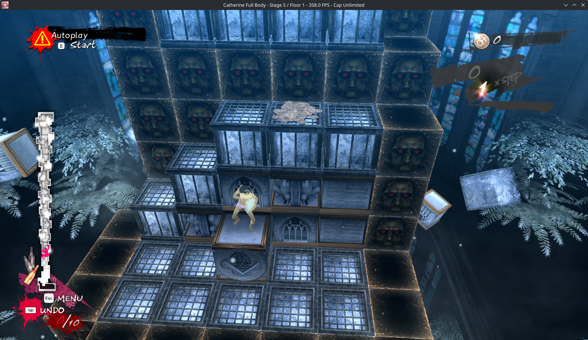
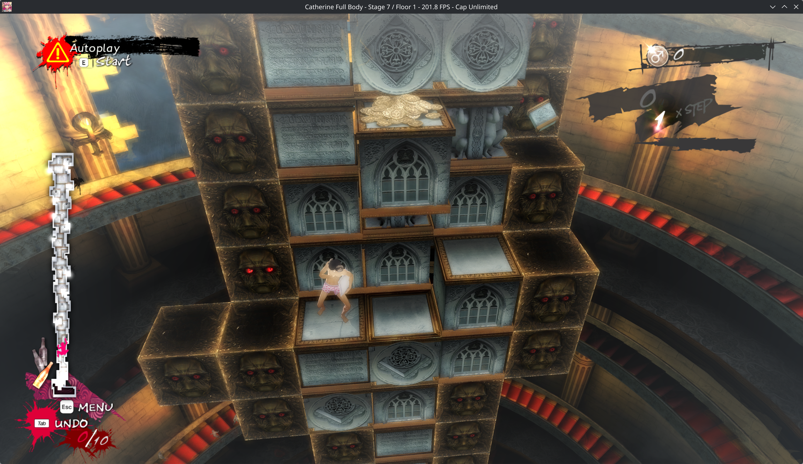
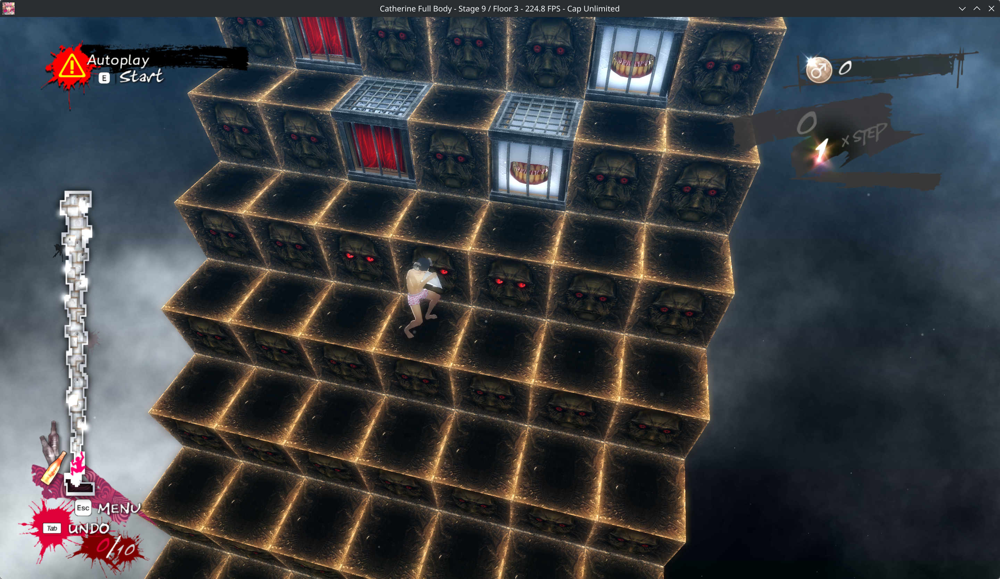

# Catherine: Full Body PC Port

Based on the Switch version of the game, there was already a recomp of this game available that supports the PS4 version but that version is still locked to 30fps and is more of a no-frill type of recomp. I'm still going to thank and appreciate its existence though, because this was what got me interested in the game again.

## Features

- Native Windows and Linux support.
- 60 FPS by default, with an uncapped option. Code patches and interpolation enable higher frame rates, including interpolation for puzzle levels.
- In-game PC settings and full keyboard and mouse support.
- Button prompts switch automatically between keyboard and mouse icons and the active controller’s icons.
- Local co-op. Online play has been removed. Babel Pair and Colosseum automatically use local co-op and stay greyed out until two distinct input devices are connected and assigned.
- An F8 menu for jumping directly to levels and cutscenes.

## Screenshots

Configuration and bindings (4K)

| | |
| --- | --- |
|  Game |  Display |
|  Controls |  System |
|  Audio |  Player 1 bindings |
|  Player 2 bindings |  |

Ten puzzle floors on Linux with live FPS

| | |
| --- | --- |
|  Stage 1, Floor 1 |  Stage 2, Floor 2 |
|  Stage 2, Floor 3 |  Stage 3, Floor 3 |
|  Stage 5, Floor 1 |  Stage 7, Floor 1 |
|  Stage 7, Floor 2 |  Stage 8, Floor 1 |
|  Stage 9, Floor 3 |  Stage 9, Floor 5 |

## Installation

1. Use your own fully decrypted, extracted copy of the North American or European Nintendo Switch release (title ID `0100BF00112C0000`) and its 1.0.1 update. You can use a tool such as NSPUnpacker to prepare the files. The port accepts extracted files only.
2. On Windows, launch `Catherine.exe` and point setup at the extracted files when prompted. Setup builds `assets.pak`, then generates the Vulkan shaders. See the [Windows setup guide](Source/resources/INSTALL-ASSETS.txt) for details.
3. On Linux, use a prepared `assets.pak` that already contains the Vulkan shaders. Run `./Build/catherine --assets-pak /path/to/assets.pak`.

## Planned

- Further optimisation.
- A custom level editor.
- Restore the voting system. Other online features are outside my plans, but forks and pull requests are welcome.

## AI

Yes.
