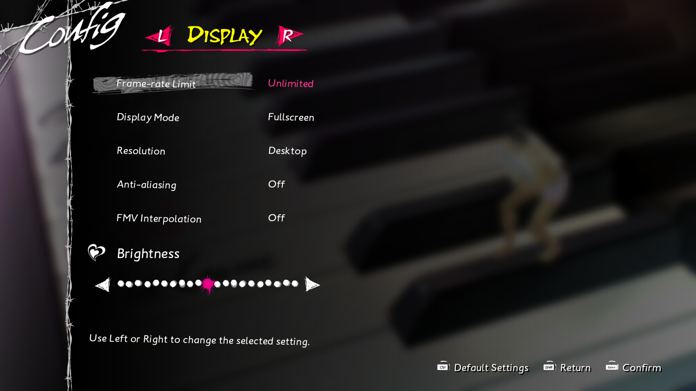
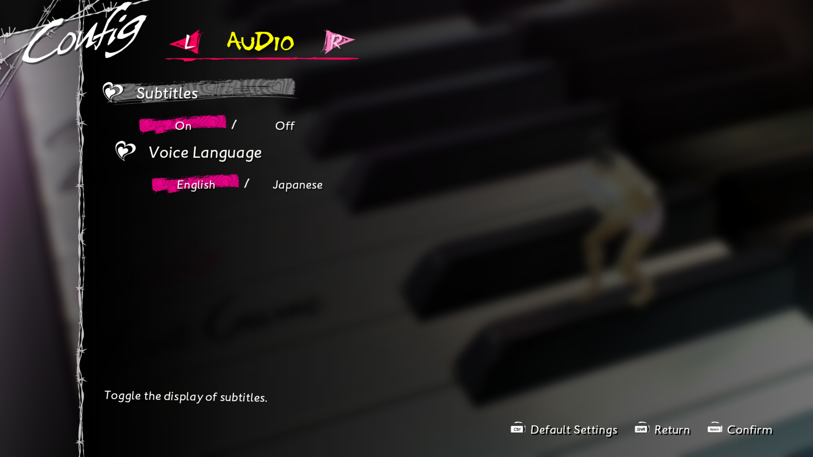
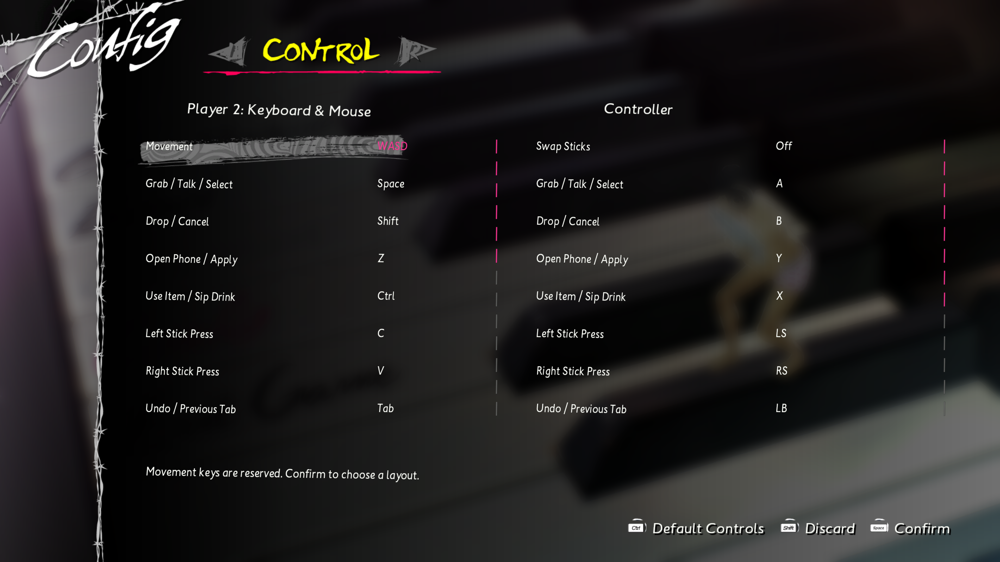
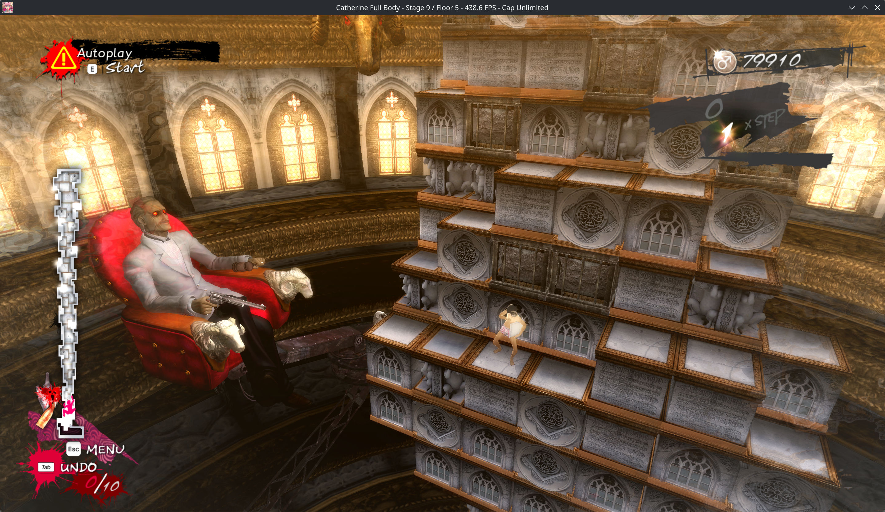

# Catherine: Full Body PC Port

Based on the Switch version of the game, there was a shadps4 wrapper of this game available but that version is still locked to 30fps and is more of a no-frill type of recomp. I'm still going to thank and appreciate its existence though, because this was what got me interested in the game again.

I will say this has been a way more complicated port than anything else I've released so I'm less confident about this one.

## Features

- Native Windows and Linux support.
- 60 FPS by default, with an uncapped option. Code patches and interpolation enable higher frame rates, You'd be surprised just how many things broke when you go over 30 fps, most have been fixed but there may be minor things left that still run at the wrong speed.
- FSR 1 upscaling, NVIDIA DLSS Frame Generation (2× / 3× / 4× on supported hardware), and an optional on-screen FPS counter.
- Full keyboard and mouse support.
- Button prompts switch automatically between keyboard and mouse icons and the active controller’s icons.
- Updated Menus, Xbox controllers and more now have updated tutorials.
- Real game configuration options that are inside of the game like a real PC game. Includes things like MSAA anti-aliasing and FMV smoothing.
- Local co-op. Online play had to be removed. Babel Pair and Colosseum automatically use local co-op and stay greyed out until two distinct input devices are connected and assigned.

## Screenshots


<details>
<summary>Configuration and bindings (4K)</summary>

| | |
| --- | --- |
| <br>Game | <br>Display |
| <br>Controls | <br>System |
| <br>Audio | <br>Player 1 bindings |
| <br>Player 2 bindings |  |

</details>

<details>
<summary>Ten puzzle floors on Linux with live FPS</summary>

| | |
| --- | --- |
| <br>Stage 1, Floor 1 | <br>Stage 2, Floor 2 |
| <br>Stage 2, Floor 3 | <br>Stage 3, Floor 3 |
| <br>Stage 5, Floor 1 | <br>Stage 7, Floor 1 |
| <br>Stage 7, Floor 2 | <br>Stage 8, Floor 1 |
| <br>Stage 9, Floor 3 | <br>Stage 9, Floor 5 |

</details>

## System requirements

These are estimated hardware targets for 1080p with anti-aliasing off, not verified minimum requirements. Performance will vary by scene and settings; Linux hardware targets have not been separately validated.

| Component | 1080p / 60 FPS target | 1080p / 120 FPS target |
| --- | --- | --- |
| CPU | Intel Core i5-10400 / AMD Ryzen 5 3600 or equivalent | Intel Core i5-12400F / AMD Ryzen 5 5600 or equivalent |
| GPU | NVIDIA GeForce GTX 1660 Super / AMD Radeon RX 5600 XT or equivalent | NVIDIA GeForce RTX 3060 Ti / AMD Radeon RX 6700 XT or equivalent |
| RAM | 8 GB estimated minimum; 16 GB recommended | 16 GB |
| Storage | 20 GB free for the installed game; allow approximately 35 GB during setup, including extracted game files | Same |

A 64-bit x86-64-v3-capable CPU and a Vulkan-capable graphics card with current drivers are required.

## Installation

1. Decrypt and extract your own North American or European Switch copy (`0100BF00112C0000`) with update **1.0.1**, using a tool such as NSPUnpacker.
2. Launch `Catherine.exe` on Windows or `./Build/catherine` on Linux, then select the extracted folder.
3. Setup builds `assets.pak`, then generates the Vulkan shaders.

The update is usually unpacked with the main game. It can also be extracted separately; if so, select its folder when setup asks for the update files.

Linux setup also needs SPIRV-Tools and either KDialog or Zenity. See the [Windows setup guide](Source/resources/INSTALL-ASSETS.txt) for more details.

### Example extracted folder structure

Typical layout when the game and update are extracted together:

```text
ExtractedGame/
├── exefs/
│   ├── main
│   ├── sdk
│   └── ...
└── romfs/
    └── data/
        ├── Base.cpk
        ├── Model.cpk
        ├── movie/
        ├── movie2/
        └── ...
```

Select `ExtractedGame`, keeping all files inside it. `...` means other files are omitted from this example.

## Upscaling and frame generation

Edit `catherine-settings.ini` beside the executable, then restart. These options are INI-only for now:

```ini
[Catherine]
Upscaler=off
UpscaleQuality=quality
FsrSharpness=20
FrameGeneration=off
FrameGenerationMultiplier=4
ShowFps=false
```

Use `Upscaler=fsr1` for FSR 1. Quality choices are `ultraquality`, `quality`, `balanced`, and `performance`; sharpness ranges from 0 to 100.

Set `FrameGeneration=dlssg` to enable DLSS Frame Generation. It currently supports Windows with a compatible NVIDIA GPU. The multiplier is limited to what the GPU supports. It uses the bundled `Streamline` folder and falls back to normal rendering if unavailable. Generation pauses during loading and video playback. FSR 1 also works alongside it.

`Fps` caps rendered frames: `Fps=60` with 4× targets 240 displayed FPS. The counter shows actual displayed FPS and rendered FPS when generation is running. Set `ShowFps=true` to show it. Upscaling, frame generation, and the counter all default to off.

## Compile from source

Clone the repository and run these commands from its folder. Game files are not needed to compile.

### Linux

Install Python 3, Clang, LLD, .NET 10 SDK, pkg-config, and development packages for Vulkan, SDL2, Cairo, OpenSSL and FFmpeg (`libavcodec`, `libavutil`, `libswscale`). Then build and launch:

```sh
python3 build.py
./Build/catherine
```

Linux requires an x86-64-v3-capable CPU. `--pgo` is not supported.

### Windows

Install Python 3, .NET 10 SDK, Vulkan SDK, and Visual Studio with the C++ desktop workload, LLVM/Clang tools and Windows SDK.

**Windows compilation currently requires the configured developer environment.** For other machines, use the Windows release or build on Linux.

In the configured checkout, open Developer PowerShell and run:

```powershell
New-Item -ItemType Directory -Force Build\obj | Out-Null
python build.py
```

The executable is `Build\catherine.exe`.

## Planned

- Further optimisation.
- A custom level editor.
- DLSS Super Resolution and further graphics options.
- Restore the voting system. Other online features are outside my plans, but forks and pull requests are welcome.

## AI

Yes. I used AI.
