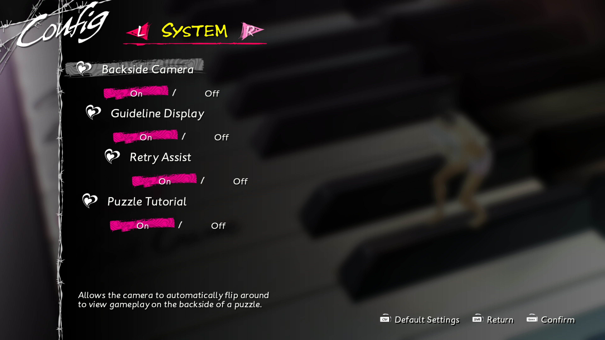
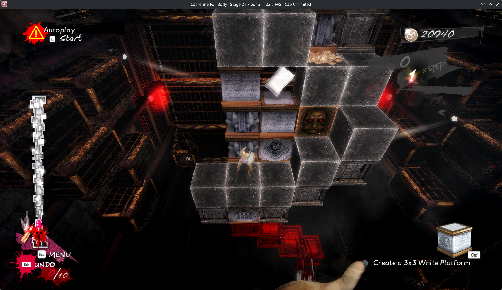

# Catherine: Full Body PC Port

Based on the Switch version of the game, there was a shadps4 wrapper of this game available but that version is still locked to 30fps and is more of a no-frill type of recomp. I'm still going to thank and appreciate its existence though, because this was what got me interested in the game again.

I will say this has been a way more complicated port than anything else I've released so I'm less confident about this one.

## Features

- Native Windows and Linux support.
- 60 FPS by default, with an uncapped option. Code patches and interpolation enable higher frame rates, You'd be surprised just how many things broke when you go over 30 fps, most have been fixed but there may be minor things left that still run at the wrong speed.
- Full keyboard and mouse support.
- Button prompts switch automatically between keyboard and mouse icons and the active controller’s icons.
- Updated Menus, Xbox controllers and more now have updated tutorials.
- Real game configuration options that are inside of the game like a real PC game. Includes things like MSAA anti-aliasing and FMV smoothing.
- Local co-op. Online play had to be removed. Babel Pair and Colosseum automatically use local co-op and stay greyed out until two distinct input devices are connected and assigned.

## Screenshots


<details>
<summary>Configuration and bindings (4K)</summary>

| | |
| --- | --- |
| <br>Game | <br>Display |
| <br>Controls | <br>System |
| <br>Audio | <br>Player 1 bindings |
| <br>Player 2 bindings |  |

</details>

<details>
<summary>Ten puzzle floors on Linux with live FPS</summary>

| | |
| --- | --- |
| <br>Stage 1, Floor 1 | <br>Stage 2, Floor 2 |
| <br>Stage 2, Floor 3 | <br>Stage 3, Floor 3 |
| <br>Stage 5, Floor 1 | <br>Stage 7, Floor 1 |
| <br>Stage 7, Floor 2 | <br>Stage 8, Floor 1 |
| <br>Stage 9, Floor 3 | <br>Stage 9, Floor 5 |

</details>

## Installation

1. Decrypt and extract your own North American or European Switch copy (`0100BF00112C0000`) with update **1.0.1**, using a tool such as NSPUnpacker.
2. Launch `Catherine.exe` on Windows or `./Build/catherine` on Linux, then select the extracted folder.
3. Setup builds `assets.pak`, then generates the Vulkan shaders.

The update is usually unpacked with the main game. It can also be extracted separately; if so, select its folder when setup asks for the update files.

Linux setup also needs SPIRV-Tools and either KDialog or Zenity. See the [Windows setup guide](Source/resources/INSTALL-ASSETS.txt) for more details.

### Example extracted folder structure

Typical layout when the game and update are extracted together:

```text
ExtractedGame/
├── exefs/
│   ├── main
│   ├── sdk
│   └── ...
└── romfs/
    └── data/
        ├── Base.cpk
        ├── Model.cpk
        ├── movie/
        ├── movie2/
        └── ...
```

Select `ExtractedGame`, keeping all files inside it. `...` means other files are omitted from this example.

## Compile from source

Clone the repository and run these commands from its folder. Game files are not needed to compile.

### Linux

Install Python 3, Clang, LLD, .NET 10 SDK, pkg-config, make, xz, and development packages for Vulkan, SDL2, Cairo, and OpenSSL. Then build FFmpeg and the game:

```sh
bash Source/tools/build_bundled_ffmpeg.sh
python3 build.py
./Build/catherine
```

Keep `ffmpeg-runtime/` beside the executable for bundled playback. Linux requires an x86-64-v3-capable CPU. `--pgo` is not supported.

### Windows

Install Python 3, .NET SDK 10.0.203 (pinned in `global.json`), Vulkan SDK, and Visual Studio with the C++ desktop workload, LLVM/Clang tools and Windows SDK.

**Windows compilation currently requires the configured developer environment.** For other machines, use the Windows release or build on Linux.

In the configured checkout, open Developer PowerShell and run:

```powershell
New-Item -ItemType Directory -Force Build\obj | Out-Null
python build.py
```

The executable is `Build\catherine.exe`.

The default build now includes native GPU skinning, the selected CPU/rendering
optimizations and higher-resolution shadows. The O3 + ThinLTO compiler profile is
included in the repository; a separate experimental source folder is unnecessary.
See [the native renderer build notes](Source/native-renderer/README.md) for source
layout and verification commands.

## Planned

- Further optimisation, especially for handhelds.
- Support for other versions of the game.
- A custom level editor.
- More configuration options like FSR and DLSS.
- Restore the voting system. Other online features are outside my plans, but forks and pull requests are welcome.

## AI


Yea.

