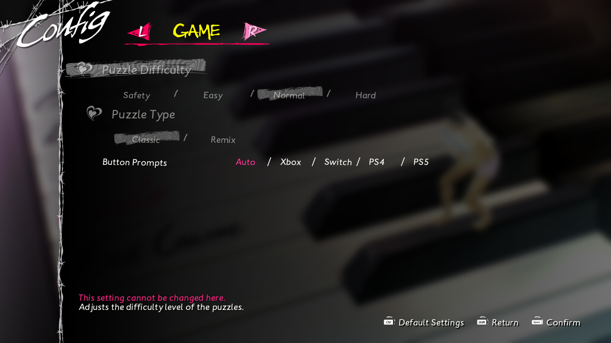
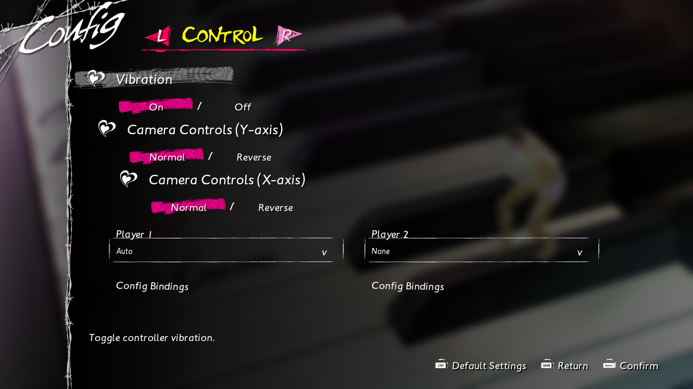
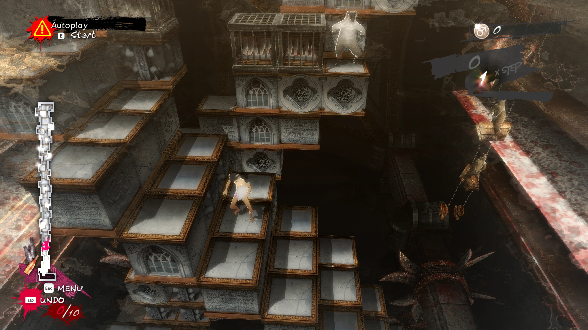
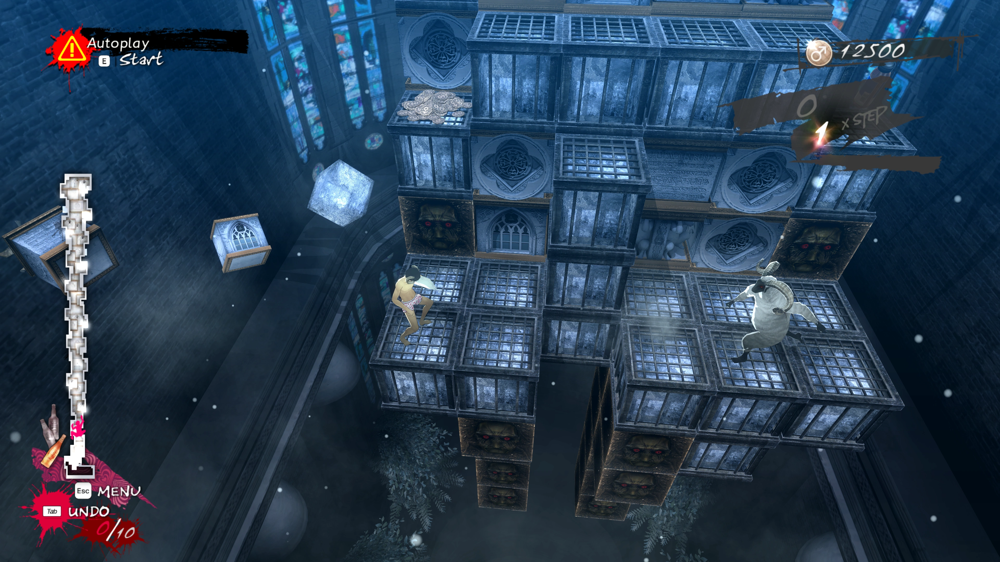
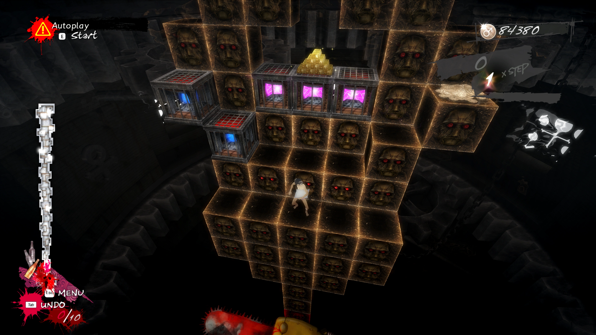
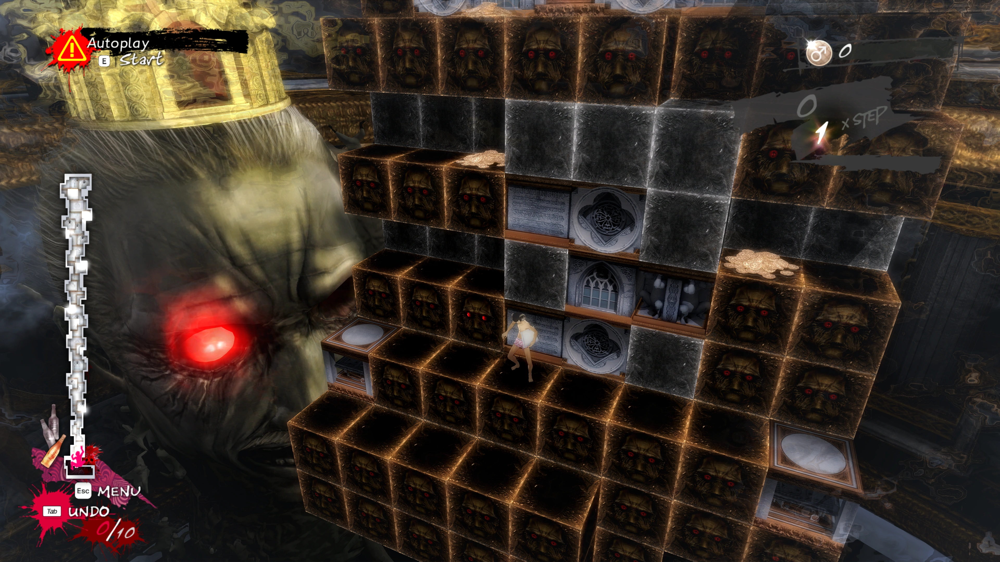
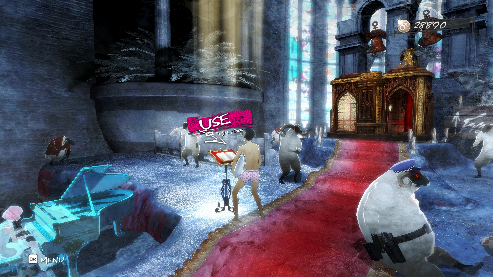
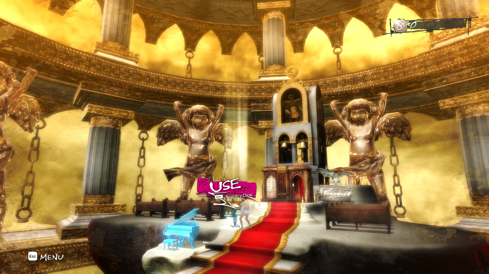

# Catherine: Full Body PC Port

Based on the Switch version of the game, there was a shadps4 wrapper of this game available but that version is still locked to 30fps and is more of a no-frill type of recomp. I'm still going to thank and appreciate its existence though, because this was what got me interested in the game again.

I will say this has been a way more complicated port than anything else I've released so I'm less confident about this one.

## Features

- Native Windows and Linux support.
- 60 FPS by default, with an uncapped option. Code patches and interpolation enable higher frame rates, You'd be surprised just how many things broke when you go over 30 fps, most have been fixed but there may be minor things left that still run at the wrong speed.
- Full keyboard and mouse support.
- Button prompts switch automatically between keyboard and mouse icons and the active controller’s icons.
- Updated Menus, Xbox controllers and more now have updated tutorials.
- Real game configuration options that are inside of the game like a real PC game. Includes things like MSAA anti-aliasing and FMV smoothing.
- Local co-op. Online play had to be removed. Babel Pair and Colosseum automatically use local co-op and stay greyed out until two distinct input devices are connected and assigned.

## Screenshots

Piano menu and gameplay captures: 3840×2160, MSAA 8×, and 8192×8192 shadows on Windows.


<details>
<summary>Configuration and bindings (4K)</summary>

| | |
| --- | --- |
| <br>Game | <br>Display |
| <br>Controls | <br>System |
| <br>Audio | <br>Player 1 bindings |
| <br>Player 2 bindings |  |

</details>

<details>
<summary>Eight puzzle stages and two confessional landings (4K)</summary>

| | |
| --- | --- |
| <br>Stage 1, Floor 1 | <br>Stage 2, Floor 2 |
| <br>Stage 3, Floor 1 | <br>Stage 5, Floor 2 |
| <br>Stage 6, Floor 4 | <br>Stage 7, Floor 1 |
| <br>Stage 8, Floor 1 | <br>Stage 9, Floor 6 |
| <br>Quadrangle landing after Stage 5, Floor 2 | <br>Day 9, fifth landing |

</details>

## Installation

1. Decrypt and extract your own North American or European Switch copy (`0100BF00112C0000`) with update **1.0.1**, using a tool such as NSPUnpacker.
2. Launch `Catherine.exe` on Windows or `./catherine` from the extracted Linux release folder, then select the extracted folder.
3. Setup builds `assets.pak`, then generates the Vulkan shaders.

The update is usually unpacked with the main game. It can also be extracted separately; if so, select its folder when setup asks for the update files.

Linux setup also needs SPIRV-Tools and either KDialog or Zenity. See the [Windows setup guide](Source/resources/INSTALL-ASSETS.txt) for more details.

### Example extracted folder structure

Typical layout when the game and update are extracted together:

```text
ExtractedGame/
├── exefs/
│   ├── main
│   ├── sdk
│   └── ...
└── romfs/
    └── data/
        ├── Base.cpk
        ├── Model.cpk
        ├── movie/
        ├── movie2/
        └── ...
```

Select `ExtractedGame`, keeping all files inside it. `...` means other files are omitted from this example.

## Launcher integration

Release packaging includes `recomplauncher.json` for [Recomp Launcher](https://recomplauncher.com)
and compatible [Quiver Launcher](https://quiverlauncher.com) versions. Select your extracted game folder;
select the extracted 1.0.1 update separately only if it is not already merged.
Recomp Launcher runs setup without a separate setup window. Quiver reads the
same launch/settings profile; its catalog supplies the game/update selections and
save-backup locations, and Catherine's own setup window handles the first launch.

Launcher-managed sessions use `RECOMPLAUNCHER_DATA` for `assets.pak`, saves,
settings and logs, with disposable caches under `cache/`. Ordinary launches keep
using the folder beside the executable. Existing standalone saves are not moved
or overwritten; copy `save.dat` and `catherine-settings.ini` into the launcher's
`recompdata` folder to continue an existing game there.

The same executable supports `--prepare --game=FOLDER --update=FOLDER` for setup
without starting the game. Omit `--update` when the update is merged. Without
`RECOMPLAUNCHER_DATA`, setup uses the executable's folder. No game files or keys
are included in the release. See [launcher integration notes](Source/launcher-integration.md)
for validation and the remaining optional integrations.

## Compile from source

Clone the repository and run these commands from its folder. Game files are not needed to compile.

### Linux

Install Git, Python 3, Clang, LLD, **.NET SDK 10.0.203** (the exact version pinned in `global.json`), pkg-config, make, xz, and development packages for Vulkan, SDL2, Cairo, and OpenSSL. The CI build uses Ubuntu 24.04.

Fetch the matching Vulkan headers, then build FFmpeg and the game from the repository root:

```sh
mkdir -p Build
git clone --depth 1 --branch v1.4.363 https://github.com/KhronosGroup/Vulkan-Headers.git Build/vulkan-headers
export CATHERINE_VULKAN_INCLUDE="$PWD/Build/vulkan-headers/include"
python3 Source/tools/check_ci_toolchain.py
bash Source/tools/build_bundled_ffmpeg.sh 2
python3 build.py --jobs 2
./Build/catherine
```

The header clone is a one-time setup step. System Vulkan headers alone must be version 1.4.363 or newer. Keep `ffmpeg-runtime/` beside the executable for bundled playback. Linux requires an x86-64-v3-capable CPU. The default Linux build uses O3 and ThinLTO. Use `--pgo` with a [locally trained Linux profile](Source/native-renderer/README.md#linux-profile-guided-builds).

### Windows

Install Git, Python 3, **.NET SDK 10.0.203** (pinned in `global.json`), and Visual Studio with the C++ desktop workload, LLVM/Clang tools and Windows SDK. The selected compiler profile was produced with LLVM 22.1.3; use that version for the matching local toolchain.

The recorded Windows recipes require the repository at `C:\catherine\recomp` (or a directory junction there pointing to your checkout). In that checkout, open Developer PowerShell and run:

```powershell
New-Item -ItemType Directory -Force Build\obj | Out-Null
git clone --depth 1 --branch v1.4.363 https://github.com/KhronosGroup/Vulkan-Headers.git Build/vulkan-headers
$vswhere = "${env:ProgramFiles(x86)}/Microsoft Visual Studio/Installer/vswhere.exe"
$vs = & $vswhere -latest -products '*' -property installationPath
$clang = "$vs/VC/Tools/Llvm/x64/bin/clang.exe"
& $clang --version
python Source/tools/prepare_windows_ci.py --clang "$clang"
python Source/tools/check_ci_toolchain.py
python build.py --jobs 2
```

The header clone is a one-time setup step. If LLVM is installed separately, set `$clang` to its `clang.exe` before running `prepare_windows_ci.py`; `clang++.exe` and `llvm-rc.exe` must be in the same directory. That script updates the local build manifest for your compiler and downloaded Vulkan headers.

The executable is `Build\catherine.exe`.

The default build now includes native GPU skinning, the selected CPU/rendering
optimizations and higher-resolution shadows. The O3 + ThinLTO compiler profile is
included in the repository; a separate experimental source folder is unnecessary.
See [the native renderer build notes](Source/native-renderer/README.md) for source
layout and verification commands.

## Planned Updates in Order of Importance

- Support for other versions of the game. This is HIGH priority, I will be working on this after build 2.4!
- More configuration options like FSR and DLSS.
- Restore the voting system. Other online features are outside my plans, but forks and pull requests are welcome.
- A custom level editor.

## AI


Yea.

Hi RyuseiHikari.~
